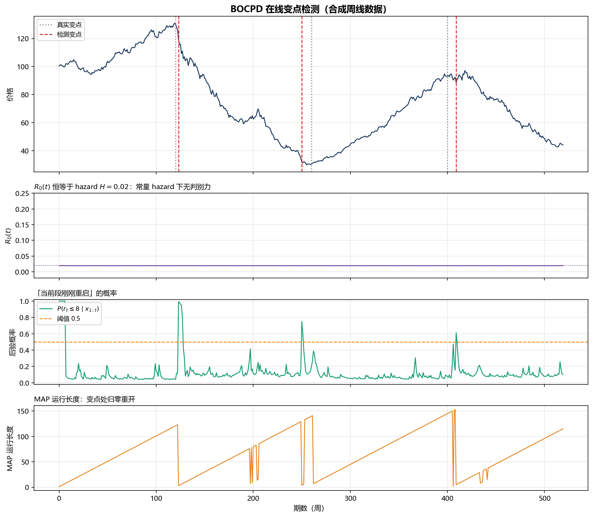
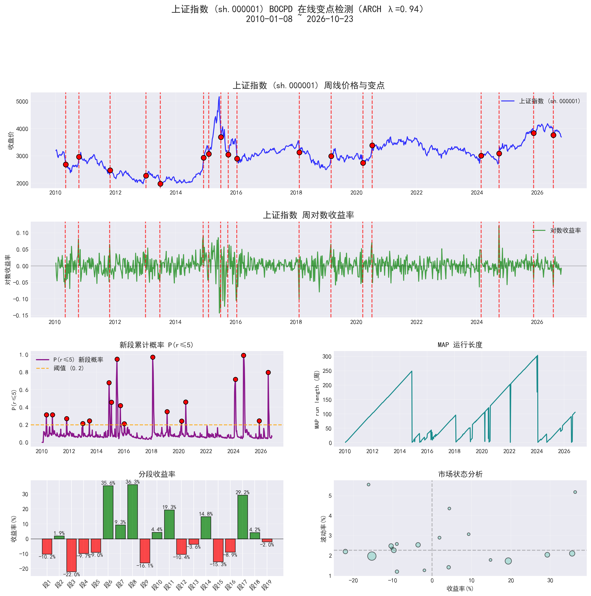
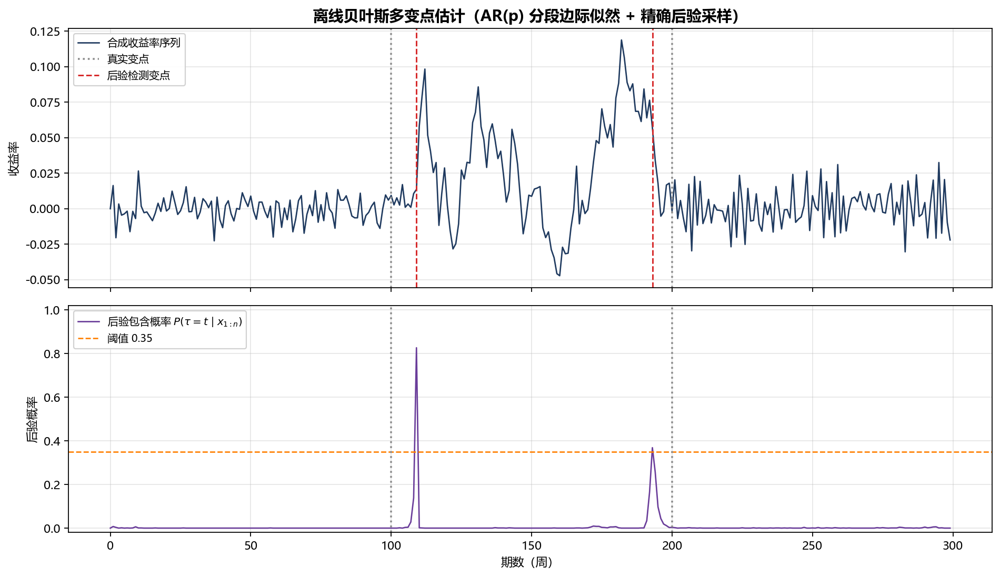

# Bayesian Changepoint Detection

Bayesian change-point estimation for weekly A-share index/stock series: **online BOCPD** plus an
**offline product-partition model with exact posterior inference**. Pure NumPy/SciPy, no training
and no labels — just ask the data when the rules changed.

[中文](README.md) | **English**



---

## What is this

A stock index does not follow one statistical law for 15 years. There are slow bulls, crashes and
long sideways stretches, each with its own mean and volatility. A **change point** is a date where
that law switches. This project slices a series into those regimes with two Bayesian methods:

| | Method | Inference | Output |
|---|---|---|---|
| **Online** | BOCPD (Adams & MacKay, 2007) | Run-length posterior, one step at a time, $O(Tr)$ | Probability of a new segment, MAP run length, live alerts |
| **Offline** | Product-partition model (Barry & Hartigan, 1993) | AR(p) segment marginal likelihood + forward–backward, exact posterior | Posterior inclusion probability for every date |

Both integrate out the segment parameters analytically (NIG / Normal-Gamma conjugacy), so there is
**no MCMC convergence, no learning rate, and results are reproducible**.

---

## Quick start

```bash
pip install -r requirements.txt
python examples/demo_bocpd.py      # online BOCPD demo → examples/figures/
python examples/demo_offline.py    # offline exact-posterior demo
```

Run it on real market data (needs `baostock`, pulls weekly forward-adjusted bars):

```bash
python legacy/bocpd_online_gui.py       # online version with a Tkinter UI
python legacy/bayesian_offline_gui.py   # offline version with a Tkinter UI
```

Use it as a library:

```python
import numpy as np
from src.bocpd import BOCPDConfig, BOCPDDetector

# returns = weekly log returns
det = BOCPDDetector(BOCPDConfig(hazard=1 / 50, short_run_k=8))
change_points = det.fit(returns)

det.changepoint_probs   # R[0] — see "the trap" below
det.short_run_probs     # P(r_t <= 8 | x_{1:t}) — the informative signal
det.map_run_lengths     # MAP run length

step = det.online_step(new_return)   # live use: one call per new weekly bar
```

```python
from src.bayesian_offline import BayesConfig, BayesianChangePointDetector

det = BayesianChangePointDetector(BayesConfig(p_max=2, lambda_param=1 / 40))
cps = det.fit(returns)
det.posterior_probs     # posterior probability of a change at each date
```

---

## Real data: Shanghai Composite, 2010–2026

859 weekly bars, 18 detected change points, 19 regimes. Red lines mark detected starts of new
segments; the bottom-left panel shows per-regime return, bottom-right the regime "map"
(return vs. volatility).



What the segments line up with: the 2015 leverage bull market and crash (July 2015, prob. 0.95),
the 2018 bear market (Feb 2018, prob. 0.97), the long 2020–2024 grind, and the September 2024
policy rally (prob. 0.99).

> This particular run uses the author's **ARCH-aware extension**: the NIG predictive variance is
> blended with an EWMA conditional variance (λ = 0.94), because squared weekly returns have
> lag-1 autocorrelation ≈ 0.24. The `src/` package contains the plain NIG core; the figure is
> produced by the extended pipeline.

---

## The offline method

AR structure switches at 100 / 200 (persistence $0 \to 0.9 \to -0.5$); the posterior collapses
onto the true boundaries:



---

## A trap worth knowing: `R[0]` equals the hazard

Most BOCPD tutorials — including the original notebook this repo grew from — threshold `R[0]` as
the changepoint probability. Under a **constant hazard** that quantity is degenerate:

$$
R_t(0)=\frac{H\sum_r R_{t-1}(r)p(x_t\mid r)}{C_t},\qquad
C_t=\sum_r R_{t-1}(r)p(x_t\mid r),
$$

the numerator and denominator are identical, so $R_t(0) \equiv H$ — **independent of the data**.
No threshold will ever fire. The flat line at 0.02 in the second panel of the demo figure is
exactly this identity.

The signal lives in the *shape* of the run-length posterior instead:

- the MAP run length $\hat r_t$ collapses to zero right after a change;
- the short-run mass $P(r_t \le k \mid x_{1:t})$ jumps from ~0.05 to near 1.

`src/bocpd.py` uses the latter by default (`decision_rule="run_length"`, $k=8$); set
`decision_rule="r0"` to reproduce the original behaviour. Full derivation in
[docs/算法总结.md](docs/算法总结.md) (Chinese).

---

## Repository layout

```
.
├── src/
│   ├── bocpd.py                # BOCPD core (no GUI, no network)
│   └── bayesian_offline.py     # offline product-partition model + exact posterior sampling
├── examples/
│   ├── demo_bocpd.py           # synthetic online demo
│   ├── demo_offline.py         # synthetic offline demo
│   └── figures/                # generated and real-data figures
├── legacy/
│   ├── bocpd_online_gui.py     # original notebook cell 1: BOCPD + baostock + Tkinter
│   └── bayesian_offline_gui.py # original notebook cell 2: offline version
├── notebooks/
│   └── 贝叶斯变点估计.ipynb      # original notebook, kept verbatim
├── docs/
│   ├── 算法总结.md              # derivations, complexity, tuning, pitfalls (Chinese)
│   └── 公众号文章.md            # long-form write-up (Chinese)
├── tests/
│   └── test_algorithm.py
└── requirements.txt
```

---

## Algorithm notes

**BOCPD**

- Run length $r_t$; growth / reset recursion, fully normalised in log space;
- NIG conjugacy → Student-t predictive, $O(1)$ update per run length;
- Detection via $P(r_t \le k)$ or a MAP run-length drop, never via $R[0]$;
- $O(T \cdot r_{\max})$ total; naturally streaming.

**Offline PPM**

- AR(p) per segment with Normal-Gamma priors; $\beta$ and $\sigma^2$ integrated out analytically
  to give the segment marginal likelihood;
- backward DP for $Q(s)$, the suffix evidence sum, then exact forward sampling of change-point
  configurations (not MCMC);
- output is a posterior inclusion probability, not a point estimate;
- $O(n^2L)$; about 6 s for $n=300$ on one core.

---

## Data & disclaimer

Market data comes from [baostock](http://baostock.com) (free, no registration), weekly and
forward-adjusted. This project is for research and education only; nothing here is investment
advice.

## License

MIT
