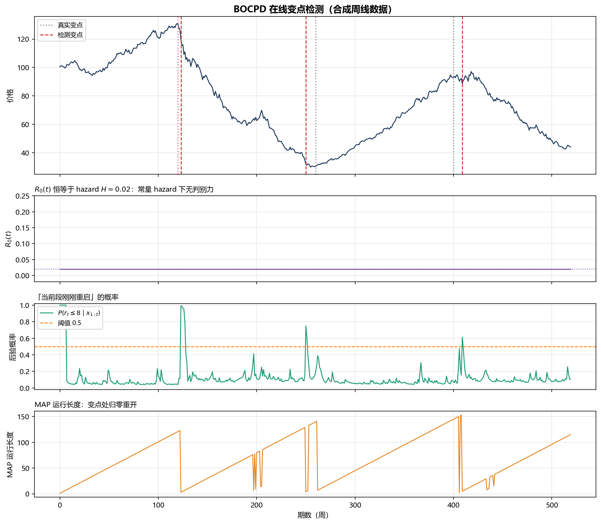
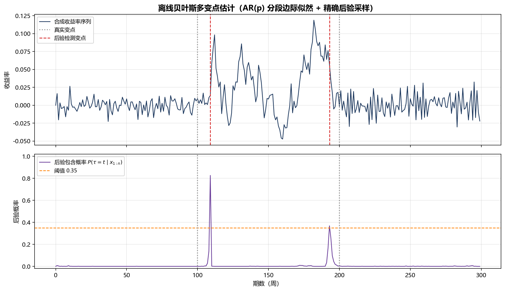
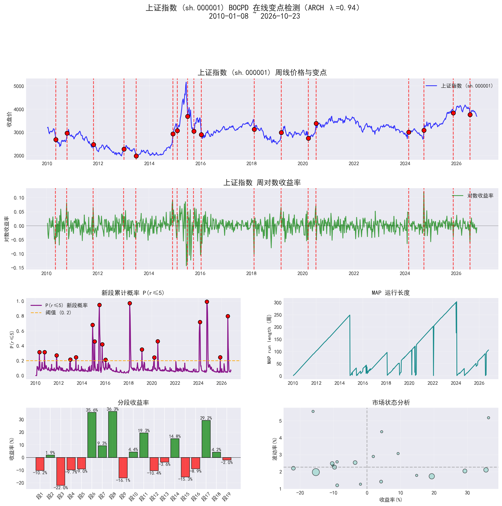

# 贝叶斯变点检测 · Bayesian Changepoint Detection

A 股周线序列上的贝叶斯变点估计：**在线 BOCPD** + **离线乘积划分模型精确后验**，
纯 NumPy/SciPy 实现，自带中文可视化、Tkinter 桌面端与完整技术笔记。

> 不用训练、不用标注，只看数据本身什么时候「换了一套规矩」。

[中文](README.md) | [English](README.en.md)



---

## 这是什么

股价在不同阶段服从不同的统计规律（慢牛、急跌、震荡），「阶段」就是**变点**之间的一段。
本项目用两种贝叶斯方法把这些阶段切出来：

| | 算法 | 推断方式 | 输出 |
|---|---|---|---|
| **在线** | BOCPD（Adams & MacKay, 2007） | 运行长度后验逐点递推，$O(Tr)$ | 变点概率曲线、MAP 运行长度、实时预警 |
| **离线** | 乘积划分模型（Barry & Hartigan, 1993） | AR(p) 分段边际似然 + 前向-后向，精确后验采样 | 每个位置的后验包含概率 |

两种方法都把「段内模型参数」解析积分掉（NIG / Normal-Gamma 共轭），
所以**不需要 MCMC 收敛、不需要调学习率**，结果可复现。

---

## 快速开始

```bash
pip install -r requirements.txt
python examples/demo_bocpd.py      # 在线 BOCPD 演示 → examples/figures/
python examples/demo_offline.py    # 离线精确后验演示
```

在真实行情上跑（需要 `baostock`，自动拉取周线前复权数据）：

```bash
python legacy/bocpd_online_gui.py       # 在线版 GUI（Tkinter）
python legacy/bayesian_offline_gui.py   # 离线版 GUI
```

作为库调用：

```python
import numpy as np
from src.bocpd import BOCPDConfig, BOCPDDetector

# returns = 周线对数收益率
det = BOCPDDetector(BOCPDConfig(hazard=1 / 50, short_run_k=8))
change_points = det.fit(returns)

det.changepoint_probs   # R[0]（见下方「一个坑」）
det.short_run_probs     # P(r_t <= 8 | x_{1:t})，真正有判别力的判据
det.map_run_lengths     # MAP 运行长度

step = det.online_step(new_return)   # 实盘：每来一根周线调用一次即可
```

```python
from src.bayesian_offline import BayesConfig, BayesianChangePointDetector

det = BayesianChangePointDetector(BayesConfig(p_max=2, lambda_param=1 / 40))
cps = det.fit(returns)
det.posterior_probs     # 每个位置是变点的后验概率
```

---

## 离线方法的效果

AR 结构在 100 / 200 处切换（持续性 $0 \to 0.9 \to -0.5$），后验几乎全部集中在真实边界附近：



---

## 真实数据：上证指数 2010–2026

859 根周线，检测出 18 个变点、19 个阶段。红色竖线是新段的起点，左下角是每段收益，
右下角是各阶段的「收益—波动」状态图。



几处对得比较准的结构：

| 检出时间 | P(r≤5) | 对应行情 |
|---|---|---|
| 2015-07-03 | 0.947 | 杠杆牛见顶、股灾开始 |
| 2018-02-09 | 0.971 | 去杠杆下的熊市起点 |
| 2024-09-27 | 0.992 | 政策底后的急速反弹 |

最长的一段是 2020-07 至 2024-02 的 184 周（−15.3%，窄幅阴跌），正是「长期没有换规矩」
的典型样本。

> 这张图由作者的 **ARCH 感知版本** 生成：NIG 的预测方差与 EWMA 条件方差按 0.5 混合，
> 因为上证周线平方收益率的 lag-1 自相关约 0.24，波动聚集很明显。`src/` 里是纯 NIG 核心，
> 该图来自扩展管线。

---

## 一个值得单独说的坑：`R[0]` 恒等于 hazard

很多 BOCPD 教程（包括本项目最初的 notebook）用 `R[0]` 当变点概率、卡 0.5 阈值。
在**常量 hazard** 下这是数学上恒成立的退化：

$$
R_t(0)=\frac{H\sum_r R_{t-1}(r)p(x_t\mid r)}{C_t},\qquad
C_t=\sum_r R_{t-1}(r)p(x_t\mid r),
$$

分子分母相同 $\Rightarrow R_t(0) \equiv H$ —— **与数据无关**，任何阈值都不会触发。
上图第二个子图里那条贴在 0.02 的水平线就是这个恒等式。

真正有信号的是**运行长度后验的形状**：

- MAP 运行长度 $\hat r_t$ 在变点处归零重开；
- 短运行长度质量 $P(r_t \le k \mid x_{1:t})$ 在变点处从 ~0.05 跳到接近 1。

本仓库的 `src/bocpd.py` 默认采用后者（可切换 `decision_rule="r0"` 复现原行为），
详情见 [docs/算法总结.md](docs/算法总结.md#26-变点判据以及一个必须知道的退化性质)。

---

## 目录结构

```
.
├── src/
│   ├── bocpd.py                # BOCPD 核心（无 GUI/网络依赖，可直接 import）
│   └── bayesian_offline.py     # 离线乘积划分模型 + 精确后验采样
├── examples/
│   ├── demo_bocpd.py           # 合成数据演示（在线）
│   ├── demo_offline.py         # 合成数据演示（离线）
│   └── figures/                # 生成的图
├── legacy/
│   ├── bocpd_online_gui.py     # 原 notebook 第一节：BOCPD + baostock + Tkinter
│   └── bayesian_offline_gui.py # 原 notebook 第二节：离线版完整程序
├── notebooks/
│   └── 贝叶斯变点估计.ipynb      # 原始 notebook（原样保留）
├── docs/
│   ├── 算法总结.md              # 公式推导、复杂度、调参、踩坑记录
│   └── 公众号文章.md            # 面向公众号读者的技术分享长文
├── README.en.md                # 英文版 README
└── requirements.txt
```

---

## 算法要点

**BOCPD**

- 运行长度 $r_t$，增长/重置两分支递推，全部在 log 域归一化；
- NIG 共轭 → 预测分布是 Student-t，单段更新 $O(1)$；
- 判据：$P(r_t \le k)$ 或 MAP 运行长度，而非 $R[0]$；
- 复杂度 $O(T \cdot r_{\max})$，天然支持流式更新。

**离线 BPM**

- 段内 AR($p$) + Normal-Gamma 先验，$\beta,\sigma^2$ 解析积分得到分段边际似然；
- 后向 DP 求 $Q(s)$（后缀证据和），再逐段精确抽样得到后验样本；
- 输出是后验包含概率，而不是点估计；
- 复杂度 $O(n^2L)$，$n=300$ 约 6 秒。

完整推导见 [docs/算法总结.md](docs/算法总结.md)。

---

## 数据与免责声明

行情数据来自 [baostock](http://baostock.com)（免费、免注册），默认取**周线、前复权**。
本项目仅用于算法研究，不构成任何投资建议。

## License

MIT
